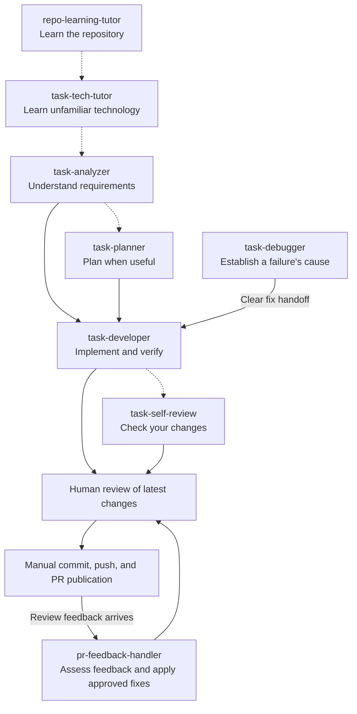

# Human in the Loop

Portable AI skills for developers who want to understand the systems they work on and stay actively involved when using AI. Learn an unfamiliar repository or technology, clarify a task, implement changes, investigate failures, and review code using the project's own evidence and conventions.

Useful at any career level, including junior, senior, staff, and principal engineers. Choose the skills that match your current needs; each has a focused scope and can be used independently when its inputs are available.

> **Unreleased — in development.** Codex marketplace installation is available for trying the development version. Stable release and workflow verification remain pending.

`repo-learning-tutor` has had brief author use. Partial `task-tech-tutor` scenario runs are recorded in local author notes; complete workflow verification across supported hosts and release checks remain pending for all thirteen skills. See [verification status](docs/installation.md#verification-status).

## Start here

- **New to the repository?** Start with `repo-learning-tutor` in Orientation mode.
- **New to the task's technology?** Use `task-tech-tutor` before analyzing the task.
- **Unsure what the task requires?** Use `task-analyzer`; add `task-planner` when implementation needs coordination.
- **Already have clear requirements?** Go directly to `task-developer` with a self-contained request.
- **Reviewing someone else's PR?** Use `pr-reviewer`; for your own changes, use `task-self-review`.

The [usage guide](docs/using-skills.md) includes copyable examples, optional steps, review choices, and session handoffs. See the [documentation index](docs/README.md) for installation and contribution guides.

## Install in Codex now

With Git and a Codex CLI that supports `codex plugin`, run this in your terminal (macOS/Linux or PowerShell 7+) once the default branch on GitHub contains the `AVAILABLE` catalog:

```sh
codex plugin marketplace add alanquintero/human-in-the-loop && codex plugin add human-in-the-loop@human-in-the-loop
```

This registers the marketplace and installs the whole development plugin; no clone or Python installer is needed. In older PowerShell, run the two commands separately and stop if registration fails. Maintainers must push the enabling catalog commit before sharing this command.

Restart Codex, open a fresh chat in the project you want to learn or change, and select a skill from the catalog below. For your first learning session, select `repo-learning-tutor` and send:

```text
Use Orientation mode to help me understand this repository.
Explain its main responsibilities and trace one representative flow.
Teach one small area at a time, then check my understanding.
```

See [Codex setup](docs/local-development.md#codex) for a local-checkout installation, registration checks, updates, uninstall, and `NOT_AVAILABLE` troubleshooting. Registration is required once; cloning alone does not register the marketplace. See [other agent setup routes](docs/local-development.md#clone-and-choose-an-agent) to try the skills outside Codex. [Stable release installation](docs/installation.md) remains planned.

### Install just one skill

The marketplace command above installs the whole plugin. To install only `repo-learning-tutor` for Codex in your current project, use the third-party [Skills CLI](https://github.com/vercel-labs/skills) with Node.js 22.20+ (including npm) and Git, without manually cloning this repository:

```sh
npx skills add alanquintero/human-in-the-loop --skill repo-learning-tutor --agent codex --copy
```

Run it from the project where you want the skill. It downloads source as needed and installs only the selected skill and its resources; add `--global` for personal installation across projects. This uses the development source, and this repository's remote Skills CLI route remains unverified. If you already have a checkout, use the Python installer's `--skill` option instead. See [single-skill examples](docs/installation.md#install-one-skill) for both routes, scopes, and other agents.

## How the skills connect

Choose the entry point that matches your need. Arrows show handoffs you choose; skills do not launch the next workflow automatically. Dashed arrows mark optional preparation or review.



Repository learning can stand alone. Skip technology tutoring when you already understand the relevant concepts; skip analysis when you can supply sufficient requirements directly to development. If a diagnosis leaves product decisions unresolved, use analysis before implementation. `pr-reviewer`, `pr-splitter`, `merge-conflict-resolver`, `github-issue-drafter`, and `skill-improver` are independent workflows described below.

For smaller implementation increments, human review and manual commits also happen between increments. Final PR text follows review and approval of the combined task. The diagram shows the overall path; see [review choices](docs/using-skills.md#choose-how-to-review-implementation) for the checkpoints.

## Skills (in development)

### Repository learning

Build general knowledge of a project independently of a particular development task.

| Skill | Purpose |
| --- | --- |
| [repo-learning-tutor](skills/repo-learning-tutor/SKILL.md) | Learn an unfamiliar code or documentation repository through orientation, guided practice, and local progress notes. |

### Task development

When preparation is needed, learn the task technology, analyze requirements, optionally plan, then develop in a new session. Self-review is optional; handle PR feedback when it arrives. Enter directly at development when you already have sufficient requirements.

| Step | Skill | Purpose |
| --- | --- | --- |
| 1 (when needed) | [task-tech-tutor](skills/task-tech-tutor/SKILL.md) | Learn the technologies and specific framework concepts the task requires before analyzing it. |
| 2 (when needed) | [task-analyzer](skills/task-analyzer/SKILL.md) | Understand the task, explain it in your own words, and approve a prompt for a separate implementation session. |
| 2a (optional) | [task-planner](skills/task-planner/SKILL.md) | Choose the review workflow, review ordered steps, and approve one prompt containing requirements and plan. |
| 3 | [task-developer](skills/task-developer/SKILL.md) | Implement and verify the whole task or agreed increments, with manual commits and text gated by human review. |
| 4 (optional) | [task-self-review](skills/task-self-review/SKILL.md) | Check local changes or a draft or open PR against task requirements, report readiness for human review, and fix findings the user accepts. |
| 5 (when feedback arrives) | [pr-feedback-handler](skills/pr-feedback-handler/SKILL.md) | Assess PR comments and their replies, propose fixes for approval, implement approved plans, and draft replies and commit text for manual use. |

Use these additional development skills independently of the numbered steps when reorganizing an existing PR, investigating failures, or resolving merge conflicts.

| Skill | Purpose |
| --- | --- |
| [task-debugger](skills/task-debugger/SKILL.md) | Investigate unexpected behavior, failing tests, or broken builds; establish the cause and hand off implementation without fixing application code. |
| [pr-splitter](skills/pr-splitter/SKILL.md) | Propose an approved split of an existing large PR, then guide manual construction and verification of smaller independent or stacked PRs. |
| [merge-conflict-resolver](skills/merge-conflict-resolver/SKILL.md) | Preserve the target branch’s changes, integrate the feature changes around them, verify the resolution, and optionally commit it locally without pushing. |

### Reviewing another contributor's PR

| Skill | Purpose |
| --- | --- |
| [pr-reviewer](skills/pr-reviewer/SKILL.md) | Validate task understanding, wait for manual review, assess the user's findings, then review for additional issues and draft accepted comments for manual posting. Read-only throughout. |

### Issue reporting

| Skill | Purpose |
| --- | --- |
| [github-issue-drafter](skills/github-issue-drafter/SKILL.md) | Draft an issue title and description from the conversation or a supplied report, following repository examples and templates, for the user to publish manually. |

### Skill maintenance

| Skill | Purpose |
| --- | --- |
| [skill-improver](skills/skill-improver/SKILL.md) | Improve existing skills from conversation feedback or a described gap, preserving core rules and permissions, and leave local changes for human review. |

## Local skill artifacts

The tutors save learning documents in the target project's hidden `.ai-skill-local/` folder, with separate `repo-learning-tutor/` and `task-tech-tutor/` subfolders. They locally exclude the whole folder through Git's `info/exclude` and verify it stays untracked and ignored before writing. They never stage or commit notes or edit the project's `.gitignore`; if safe persistence is unavailable, learning continues in chat. Existing root-level notes are preserved when resuming in the new location.

Other workflows keep conversational output in chat or edit the source files their tasks require. Task Debugger keeps authorized auxiliary artifacts in `.ai-skill-local/task-debugger/` inside an isolated scratch workspace outside the active repository.

## Supported agents (planned)

| Agent | Installation route |
| --- | --- |
| OpenAI Codex | Plugin marketplace or copy installer |
| OpenAI ChatGPT Work | Plugin marketplace |
| Anthropic Claude Code | Direct local plugin, plugin marketplace, or copy installer |
| GitHub Copilot | Local plugin (CLI) or copy installer |
| Cursor | Local Agent Plugin or copy installer |
| Google Gemini CLI | Native skill install/link or copy installer |
| Windsurf / Devin Desktop Cascade | Copy installer |
| Cline | Copy installer |
| OpenCode | Copy installer |

These setup instructions follow each provider's official documentation. Codex CLI installation from a local checkout has been checked; fresh-agent workflow runs and other hosts remain unverified. ChatGPT support refers to Work's plugin route. See [the release checklist](docs/releasing.md) before publishing a stable release.

## Documentation and contributing

| Goal | Guide |
| --- | --- |
| Choose and use skills | [Usage guide](docs/using-skills.md) |
| Try the development version, update, or uninstall | [Local usage and development](docs/local-development.md) |
| Install a stable release when available | [Release installation (planned)](docs/installation.md) |
| Contribute or add a skill | [CONTRIBUTING.md](CONTRIBUTING.md) and [authoring guide](docs/skill-authoring.md) |
| Configure an agent to work on this plugin | [Repository setup](docs/agent-setup.md) |
| Prepare a release | [Release checklist](docs/releasing.md) |

Skills use the [Agent Skills format](https://agentskills.io/specification); the plugin distributes their canonical source directories and bundled resources. To add a skill, create `skills/<name>/SKILL.md`, record representative scenarios beside it, follow contribution checks, and add it to this catalog. Declare special requirements with the skill.

## Layout

```text
plugin.json          Plugin identity and development version
skills/              Shipped skill sources, each containing SKILL.md
.agents/plugins/     Codex marketplace catalog (development install available)
.claude-plugin/      Claude Code manifest and empty unreleased catalog
.agents/plans/        Local task notes and plans (ignored by Git)
scripts/             Portable copy installer and its verification guide
tests/               Installer and packaging checks using temporary fixtures
docs/                Installation, authoring, setup, and release guides
AGENTS.md            Shared instructions for agents working on this repository
CLAUDE.md            Pointer to the shared instructions
CONTRIBUTING.md      Contribution and verification workflow
LICENSE              MIT license
```

## License

[MIT](LICENSE).
